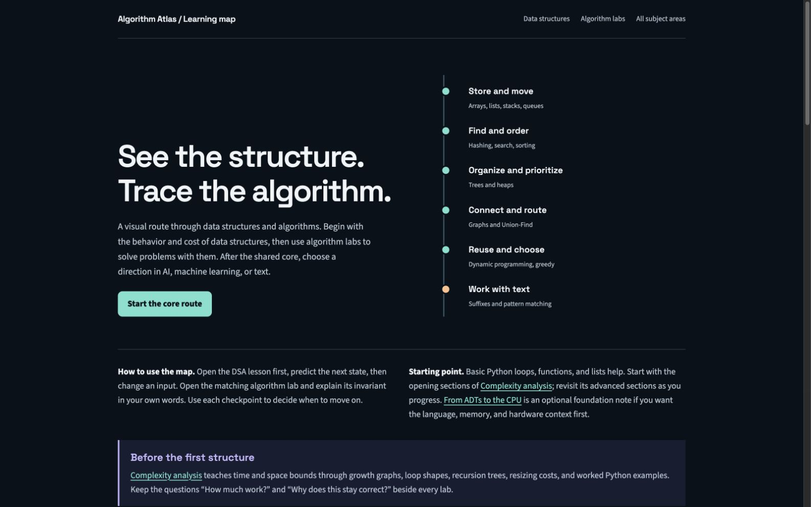

# Algorithm Atlas

Visual, interactive tutorials for data structures, algorithms, and complexity analysis, with optional AI and machine learning paths.

### [Start learning →](https://moalimir.github.io/Algorithm-Atlas/)



## Explore

- **Learning map:** follow prerequisites, choose a path, and solve checkpoints.
- **Data structures:** 12 lessons covering foundations, arrays, lists, hashing, trees, heaps, graphs, and more.
- **Algorithms, AI & ML:** 82 interactive labs across 14 subject areas.
- **Complexity analysis:** Python examples, precise mathematical visuals, guided practice, and a downloadable review sheet.

## Run locally

```sh
git clone https://github.com/moalimir/Algorithm-Atlas.git
cd Algorithm-Atlas
python3 -m http.server 8000
```

Open [localhost:8000](http://localhost:8000). No application build, npm install, or Python packages are required to read the tutorials.

## Contribute

Corrections, clearer explanations, accessible visuals, and new exercises are welcome. See [CONTRIBUTING.md](CONTRIBUTING.md) for setup, editing guidance, and checks.

```sh
python3 scripts/check_complexity.py
node scripts/check_complexity.js
```

The [maintenance guide](docs/maintenance.md) covers figure dependencies, packaging, deployment, and current source limitations.

## License

Original code and lessons are [MIT licensed](LICENSE). Embedded libraries and fonts retain their [own licenses](THIRD_PARTY_NOTICES.md).
